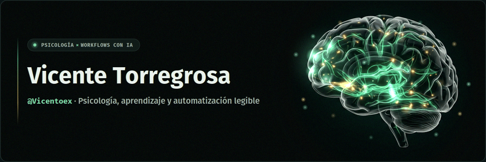

  <picture>
    <source media="(prefers-color-scheme: dark)" srcset="./assets/hero-brain-dark.gif" />
    <source media="(prefers-color-scheme: light)" srcset="./assets/hero-brain-light.gif" />
    
  </picture>

  <strong>Estudiante de Psicología · Workflows con IA aplicados al aprendizaje, la cognición y el desarrollo de personas.</strong> 
  Construyo prompts estructurados y herramientas web ligeras para convertir teoría psicológica en práctica diaria verificable.

  <a href="#enfoque-y-repositorios">Enfoque y repositorios</a> ·
  <a href="#mapa-de-dominios-y-método">Mapa de dominios</a> ·
  <a href="#contacto">Contacto</a> ·
  <a href="https://github.com/Vicentoex?tab=repositories">Todos los repositorios</a>

---

### Enfoque y repositorios

<table width="100%">
  <tr>
    <td width="52%" valign="top">
      <h4>Enfoque de trabajo</h4>
      <ul>
        <li><strong>Aprendizaje activo sin fricción</strong> — Prompts y scripts para transformar apuntes y temarios en práctica de recuerdo espaciado.</li>
        <li><strong>Criterio neuropsicológico antes del código</strong> — Atención, memoria y carga cognitiva como filtro antes de automatizar un proceso.</li>
        <li><strong>Transparencia en el alcance</strong> — Lo publicado aquí son utilidades ligeras y exploraciones verificables; lo experimental permanece fuera hasta estar documentado.</li>
      </ul>
    </td>
    <td width="48%" valign="top">
      <h4>Repositorios públicos</h4>
      <ul>
        <li><a href="https://github.com/Vicentoex/Anki"><strong>Anki</strong></a> — <em>Anki Prompt</em> y <em>Anki Tarjet Script</em>: prompts y scripts para generar tarjetas de recuerdo activo. (Markdown · Python)</li>
        <li><a href="https://github.com/Vicentoex/panel-hoy"><strong>panel-hoy</strong></a> — Panel web ligero para ordenar el foco diario sin dependencias pesadas. (HTML · CSS · JS)</li>
        <li><a href="https://github.com/Vicentoex/Pensamiento"><strong>Pensamiento</strong></a> — Exploración conceptual en web para estructurar y revisar ideas por escrito. (HTML)</li>
      </ul>
      
Espacio web en <a href="https://github.com/Vicentoex/Vicentoex.github.io">Vicentoex.github.io</a> (en construcción).

      
<strong>Stack habitual:</strong> Python · Markdown / Obsidian · Prompt Workflows · HTML / CSS / JS

    </td>
  </tr>
</table>

### Mapa de dominios y método

  <picture>
    <source media="(prefers-color-scheme: dark)" srcset="./assets/pillars-dark.svg" />
    <source media="(prefers-color-scheme: light)" srcset="./assets/pillars-light.svg" />
    
  </picture>

  <picture>
    <source media="(prefers-color-scheme: dark)" srcset="./assets/workflow-dark.svg" />
    <source media="(prefers-color-scheme: light)" srcset="./assets/workflow-light.svg" />
    
  </picture>

 

<strong>Notas de método: cómo conecto psicología y workflows con IA</strong>

1. **Primero el mecanismo cognitivo, después la herramienta.** En estudio y trabajo del conocimiento, la IA aporta más cuando reduce fricción mecánica (formateo, síntesis inicial, generación de preguntas de práctica) sin sustituir la recuperación activa (*active recall*) ni el juicio crítico.
2. **Prompts y scripts como artefactos mantenibles.** Prefiero flujos pequeños, explícitos y legibles (`Markdown`, `Python`, plantillas estructuradas) antes que automatizaciones opacas difíciles de revisar.
3. **Alcance honesto de lo publicado.** Los repositorios públicos actuales reflejan utilidades ligeras y exploraciones abiertas; las piezas nuevas se irán publicando conforme queden documentadas y listas para uso independiente.

### Contacto

Si trabajas en **educación basada en evidencia**, **workflows reproducibles con IA** o **desarrollo de talento y formación (RRHH)** y te interesa intercambiar ideas o revisar alguna herramienta publicada, puedes seguir la actividad y abrir conversación en [github.com/Vicentoex](https://github.com/Vicentoex).

---

  Vicente Torregrosa · <a href="https://github.com/Vicentoex">@Vicentoex</a> · Psicología &amp; Workflows con IA

