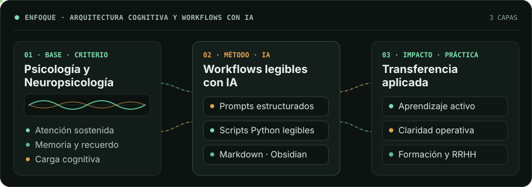
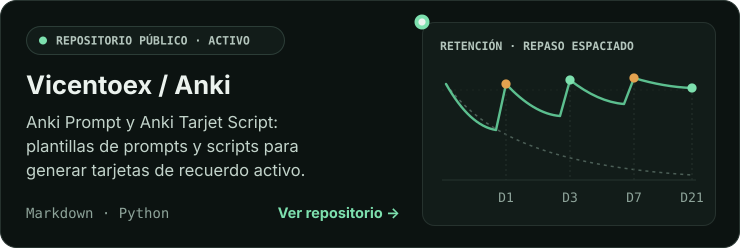

  <picture>
    <source media="(prefers-color-scheme: dark)" srcset="./assets/hero-brain-dark.gif" />
    <source media="(prefers-color-scheme: light)" srcset="./assets/hero-brain-light.gif" />
    
  </picture>

  <strong>Estudiante de Psicología · Workflows con IA aplicados al aprendizaje, la cognición y el desarrollo de personas.</strong> 
  Diseño prompts estructurados y utilidades ligeras en Python para convertir teoría psicológica en práctica de estudio verificable.

  <a href="#enfoque-y-repositorios">Enfoque y repositorios</a> ·
  <a href="#mapa-de-dominios">Mapa de dominios</a> ·
  <a href="#contacto">Contacto</a> ·
  <a href="https://github.com/Vicentoex/Anki">Repositorio Anki</a>

---

### Enfoque y repositorios

  <picture>
    <source media="(prefers-color-scheme: dark)" srcset="./assets/enfoque-anim-dark.svg" />
    <source media="(prefers-color-scheme: light)" srcset="./assets/enfoque-anim-light.svg" />
    
  </picture>

  <a href="https://github.com/Vicentoex/Anki">
    <picture>
      <source media="(prefers-color-scheme: dark)" srcset="./assets/repo-anki-dark.svg" />
      <source media="(prefers-color-scheme: light)" srcset="./assets/repo-anki-light.svg" />
      
    </picture>
  </a>

  <strong><code>Anki</code></strong> es la primera utilidad pública abierta: diseño instruccional y automatización ligera orientada a recuerdo activo. 
  <strong>Stack habitual:</strong> Python · Markdown / Obsidian · Prompt Workflows

### Mapa de dominios

  <picture>
    <source media="(prefers-color-scheme: dark)" srcset="./assets/pillars-dark.svg" />
    <source media="(prefers-color-scheme: light)" srcset="./assets/pillars-light.svg" />
    
  </picture>

 

<strong>Notas de método: cómo conecto psicología y workflows con IA</strong>

1. **Primero el mecanismo cognitivo, después la herramienta.** En estudio y trabajo del conocimiento, la IA aporta más cuando reduce fricción mecánica (formateo, síntesis inicial, generación de preguntas de práctica) sin sustituir la recuperación activa (*active recall*) ni el juicio crítico.
2. **Prompts y scripts como artefactos mantenibles.** Prefiero flujos pequeños, explícitos y legibles (`Markdown`, `Python`, plantillas estructuradas) antes que automatizaciones opacas difíciles de revisar.
3. **Alcance honesto de lo publicado.** `Anki` recoge la primera utilidad pública orientada a aprendizaje activo; las piezas nuevas se irán abriendo conforme queden listas para uso independiente.

### Contacto

Si trabajas en **educación basada en evidencia**, **workflows estructurados con IA** o **desarrollo de talento y formación (RRHH)** y te interesa intercambiar ideas o revisar alguna herramienta publicada, puedes seguir la actividad y abrir conversación en [github.com/Vicentoex](https://github.com/Vicentoex).

---

  Vicente Torregrosa · <a href="https://github.com/Vicentoex">@Vicentoex</a> · Psicología &amp; Workflows con IA

