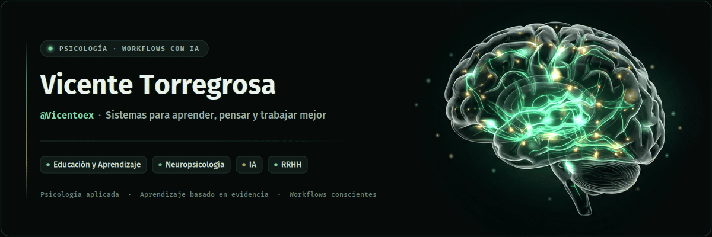
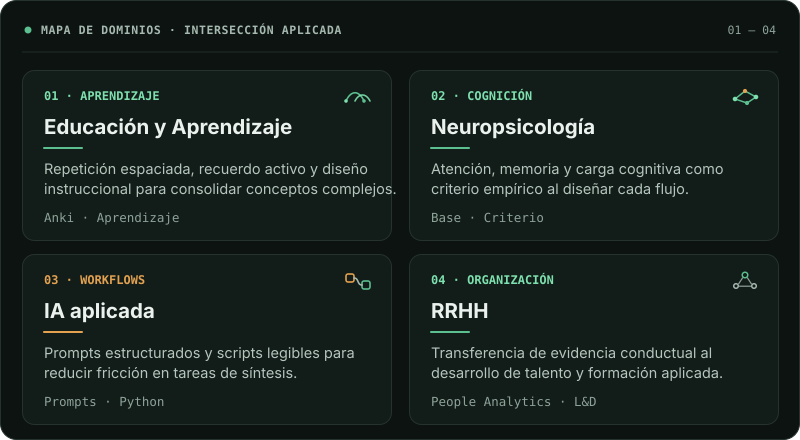
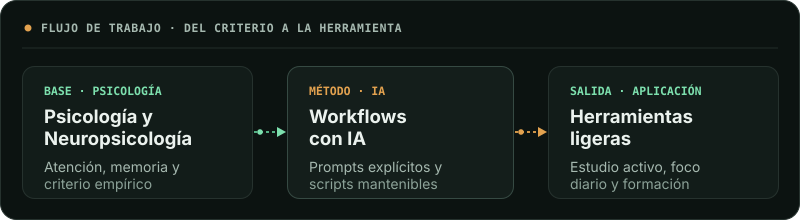

  

  <strong>Estudiante de Psicología que diseña workflows con IA para aprender, pensar y trabajar con menos fricción.</strong> 
  Intersección entre psicología aplicada, neuropsicología, automatización reproducible y desarrollo de personas.

  <a href="#lineas-de-trabajo">Líneas de trabajo</a> ·
  <a href="#repositorios-publicos">Repositorios públicos</a> ·
  <a href="#mapa-de-dominios">Mapa de dominios</a> ·
  <a href="https://github.com/Vicentoex?tab=repositories">Todos los repositorios</a>

---

<table width="100%">
  <tr>
    <td width="54%" valign="top">
      <h3 id="lineas-de-trabajo">Cuatro líneas de intersección</h3>
      
Trabajo en el cruce entre cómo procesamos información y cómo estructuramos herramientas digitales para sostener ese esfuerzo sin ruido innecesario:

      <ul>
        <li><strong>Educación y Aprendizaje</strong> — Diseño instruccional, aprendizaje activo y sistemas de repetición espaciada orientados a retener conceptos complejos a largo plazo.</li>
        <li><strong>Neuropsicología</strong> — Atención, memoria, carga cognitiva y criterio empírico como base antes de diseñar cualquier flujo o interfaz.</li>
        <li><strong>IA aplicada</strong> — Workflows reproducibles, diseño de prompts y pequeños scripts que convierten tareas repetitivas de estudio o documentación en procesos claros.</li>
        <li><strong>RRHH</strong> — Aplicación de evidencia conductual y análisis de personas (<em>People Analytics</em>) a procesos de formación y desarrollo de talento.</li>
      </ul>
    </td>
    <td width="46%" valign="top">
      <h3 id="repositorios-publicos">Repositorios públicos</h3>
      
Selección pública en evolución:

      <ul>
        <li><a href="https://github.com/Vicentoex/Anki"><strong><code>Anki</code></strong></a> — <em>Anki Prompt</em> y <em>Anki Tarjet Script</em>: estructura de prompts y automatización para generar tarjetas orientadas a recuerdo activo.</li>
        <li><a href="https://github.com/Vicentoex/panel-hoy"><strong><code>panel-hoy</code></strong></a> — Panel web personal ligero (<code>HTML</code> · <code>CSS</code> · <code>JS</code>) pensado para ordenar el foco diario sin dependencias pesadas.</li>
        <li><a href="https://github.com/Vicentoex/Pensamiento"><strong><code>Pensamiento</code></strong></a> — Exploración conceptual en web (<code>HTML</code>) para estructurar y revisar ideas por escrito.</li>
        <li><a href="https://github.com/Vicentoex/Vicentoex.github.io"><strong><code>Vicentoex.github.io</code></strong></a> — Espacio base para futura publicación web en GitHub Pages (<em>en desarrollo</em>).</li>
      </ul>
      
<strong>Herramientas habituales</strong> 
      <code>Python</code> · <code>Obsidian</code> · <code>Prompt Workflows</code> · <code>HTML / CSS / JS</code>

    </td>
  </tr>
</table>

<h3 id="mapa-de-dominios">Mapa de dominios y método</h3>

  <picture>
    <source media="(prefers-color-scheme: dark)" srcset="./assets/pillars-dark.svg" />
    <source media="(prefers-color-scheme: light)" srcset="./assets/pillars-light.svg" />
    
  </picture>

  <picture>
    <source media="(prefers-color-scheme: dark)" srcset="./assets/workflow-dark.svg" />
    <source media="(prefers-color-scheme: light)" srcset="./assets/workflow-light.svg" />
    
  </picture>

<strong>Notas de método: cómo conecto psicología y workflows con IA</strong>

1. **Primero el mecanismo cognitivo, después la herramienta.** En estudio y trabajo del conocimiento, la IA aporta más cuando reduce fricción mecánica (formateo, síntesis inicial, generación de preguntas de práctica) sin sustituir la recuperación activa (*active recall*) ni el juicio crítico.
2. **Prompts y scripts como artefactos mantenibles.** Prefiero flujos pequeños, explícitos y legibles (`Markdown`, `Python`, plantillas estructuradas) antes que automatizaciones opacas difíciles de revisar.
3. **Alcance honesto de lo publicado.** Los repositorios públicos actuales reflejan utilidades ligeras y exploraciones abiertas; las piezas nuevas se irán publicando conforme queden documentadas y listas para uso independiente.

---

  Vicente Torregrosa · <a href="https://github.com/Vicentoex">@Vicentoex</a> · Psicología &amp; Workflows con IA

